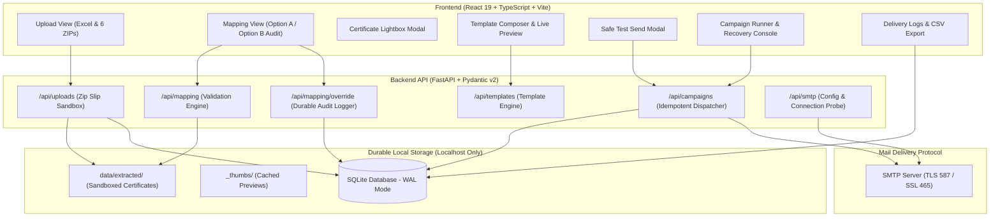

# CertiMail — Certificate Distribution & Personalized Email Automation Platform

[](https://fastapi.tiangolo.com)
[](https://react.dev)
[](https://www.typescriptlang.org)
[](https://www.python.org)
[](https://tailwindcss.com)
[](https://www.sqlite.org)
[](#11-testing--verification)

**CertiMail** is a high-reliability, locally hosted bulk email automation platform engineered specifically for collegiate symposiums, hackathons, and competitive technical events. In academic competitions, distributing participation credentials to multi-member teams is a high-stakes, labor-intensive process: each team leader must receive a personalized email containing distinct credential certificates for every team member.

CertiMail eliminates manual errors by orchestrating structured recipient data ingestion, automated certificate reference validation, durable audit overrides, live email templating, and controlled sequential SMTP delivery with zero duplicate sends.

---

## 1. Problem & Solution

### The Challenge
Event organizers managing competitions such as **Hack-O-Sprint 4.0** (72 teams, 432 participant certificates) face serious operational hurdles:
- **Partitioned Bulk Assets**: Certificates are generated by design tools into separate bulk archives split by member position (`Bulk 1` for Team Leaders, `Bulk 2–6` for Members).
- **Reference Code Drift**: Participant rosters in Excel frequently contain slight typos, re-ordered rows, or varying reference identifiers (e.g., `HOS4-2026-005-1` vs. `#5`), risking misattribution.
- **Catastrophic Dispatch Errors**: In bulk email tools, any mismatch can silently dispatch the wrong credentials or trigger accidental mass duplicate deliveries if a network glitch occurs mid-run.
- **Credential Integrity**: Sending an incorrect certificate destroys participant trust and credential authenticity.

### How CertiMail Solves It
CertiMail integrates structured spreadsheet ingestion, sandbox-extracted certificate validation, database-backed approval overrides, and an idempotent sequential SMTP dispatcher:
- Evaluates participant reference codes against extracted archive filenames.
- Enforces an un-bypassable server-side validation barrier before dispatch.
- Records durable audit trails in SQLite whenever organizers authorize reference adjustments.
- Provides a dedicated test mode with recipient override to safely inspect complete multipart attachment payloads before sending.
- Guarantees exactly-once dispatch tracking at the individual recipient level with pause, resume, and checkpointed recovery.

---

## 2. Verified Features

### Data Ingestion & File Processing
- **Excel Ingestion & Auto-Mapping**: Reads `.xlsx` workbooks with automatic heuristic column suggestion (Team ID, Team Name, Leader Name, Leader Email, Member Names, Reference Codes).
- **Sandboxed ZIP Processing**: Decompresses bulk ZIP archives with strict **Zip Slip path-traversal prevention**, directory normalization, and memory-safe streaming.
- **Thumbnail Generation**: Automatically computes and caches low-latency image thumbnails for visual verification.

### Certificate Matching & Validation Engine
- **Hierarchical & Flat Extraction**: Supports both nested folder hierarchies and flat numerical basenames (`1.png` to `72.png`).
- **Composite Reference Parsing**: Validates single and composite reference codes (`HOS4-2026-001-1`, `REF-001`) against candidate certificate numbers.
- **Certificate Preview Lightbox**: Interactive full-resolution modal to inspect signatures, verification badges, and typography.
- **Strict Preflight Barrier**: Prevents campaign creation if any team exhibits fatal errors (missing certificate files or malformed email addresses).

### Approval Overrides & Audit Trail (Option A vs. Option B)
- **Option A (Proceed with Current Mapping)**: Allows organizers to proceed directly using the engine's resolved assignments after explicit review, recording the reviewer's identity and justification in the audit trail without requiring individual manual clicks for 70+ teams.
- **Option B (Review & Edit Mapping)**: Enables granular manual inspection of individual teams, editing assigned certificate files, and logging explicit approval decisions.
- **Certificate Mapping Hash Invalidation**: Approvals are cryptographically bound to a hash of the assigned certificate filenames. If underlying ZIP files are re-uploaded or modified, prior overrides transition to `OVERRIDE_REVOKED`, re-locking the campaign gate.
- **Durable SQLite Persistence**: Overrides persist in SQLite (`approval_overrides`) across application restarts and page refreshes.

### Email Templating & Delivery Controls
- **Personalized Template Engine**: Jinja-style variable interpolation (`{{leader_name}}`, `{{team_name}}`, `{{team_id}}`, `{{participants_list}}`).
- **Global & Per-Recipient CC/BCC**: RFC-compliant recipient header construction with deduplication.
- **Dedicated Safe Test Mode**: Dispatches all actual certificate attachments to a developer-specified test address, eliminating the risk of emailing real participants during testing.
- **Sequential SMTP Delivery**: Controlled, rate-limited dispatch (configurable delays between 1.0s and 5.0s) to respect SMTP rate limits.
- **Circuit Breaker**: Instantly halts delivery on authentication failures or consecutive socket errors.
- **Idempotent Delivery Ledger**: Recipient-level state tracking (`PENDING`, `IN_PROGRESS`, `SMTP_ACCEPTED`, `FAILED`, `DELIVERY_UNKNOWN`). Accepted recipients are permanently protected against duplicate sends.
- **Checkpointed Pause / Resume**: Pauses cleanly after the in-flight email completes its SMTP conversation.
- **Template Revisions During Pause**: Supports continuing with the original template (Option A) or applying an immutable new revision (Option B) strictly to remaining un-dispatched recipients.
- **Dual Campaign Modes**: Supports both multi-attachment **Certificate Distribution** campaigns and single-message **General Personalized Mailing** campaigns.
- **Exportable Delivery Logs**: Real-time progress monitoring with one-click CSV export.

---

## 3. Screenshots and Demonstration

> [!NOTE]
> Below are representative views of the CertiMail platform. You can generate a complete realistic test dataset of 72 teams and 432 certificates using `python generate_sample_data.py` to run and explore all views locally.

### Main Dashboard & Ingestion
```
+---------------------------------------------------------------------------------------+
|  CertiMail  |  Overview  |  Upload  |  Mapping  |  Composer  |  Campaign  |  Logs    |
+---------------------------------------------------------------------------------------+
|  KPI Overview:                                                                        |
|  [ Total Teams: 72 ]   [ Certificates: 432 ]   [ Mapping Status: Ready ]              |
|                                                                                       |
|  Step 1: Upload Roster (Excel) & 6 Position ZIP Archives                             |
|  [ Drag & drop "Certificates for top 75 participants new.xlsx" ]                      |
|  [ Upload (Bulk 1).zip ... (Bulk 6).zip ] -> Verified 432 certificates extracted      |
+---------------------------------------------------------------------------------------+
```
*(Placeholder for screenshot: `docs/screenshots/01_dashboard_upload.png`)*

### Certificate Mapping & Audit Table
```
+---------------------------------------------------------------------------------------+
|  Audit Table: 72 Teams Loaded                                                         |
|  Filter: [ All (72) ] [ Mismatches (0) ] [ Approved Overrides (0) ]                   |
|  -----------------------------------------------------------------------------------  |
|  #1  Cyber Innovators 1   | HOS-2026-T001 | [1.png] [1.png] [1.png] ... | [VALID]     |
|  #2  Quantum Titans 2     | HOS-2026-T002 | [2.png] [2.png] [2.png] ... | [VALID]     |
|  -----------------------------------------------------------------------------------  |
|  Action: [ Option A: Proceed with Mapping ] or [ Option B: Review Individual Teams ]   |
+---------------------------------------------------------------------------------------+
```
*(Placeholder for screenshot: `docs/screenshots/02_mapping_audit.png`)*

### Email Composer & Live Preview
```
+---------------------------------------------------------------------------------------+
|  Subject: Participation Certificates — {{team_name}} (Hack-O-Sprint 4.0)             |
|  -----------------------------------------------------------------------------------  |
|  Dear {{leader_name}},                                                                |
|                                                                                       |
|  Congratulations to {{team_name}} on your selection among the Top 72 Teams!          |
|  Attached are your team's official participation certificates:                       |
|  {{participants_list}}                                                               |
|  -----------------------------------------------------------------------------------  |
|  Preview for Team #1: Aarav Sharma (team1.leader.aarav@example.com)                   |
|  Attachments: 6 verified PNG certificates                                             |
+---------------------------------------------------------------------------------------+
```
*(Placeholder for screenshot: `docs/screenshots/03_composer_preview.png`)*

### Safe Test Send & Sequential Campaign Runner
```
+---------------------------------------------------------------------------------------+
|  [ Safe Test Send Mode ] -> Override recipient to: operator@domain.com                |
|  Dispatches test email with all 6 real attachments for end-to-end verification.        |
|  -----------------------------------------------------------------------------------  |
|  Active Campaign #1: Dispatched 48 / 72 [==================>--------] 66%            |
|  Rate: 1 email every 2.0s | Success: 48 | Failed: 0 | Current: Team #49               |
|  Controls: [ Pause Campaign ]  [ Cancel ]                                             |
+---------------------------------------------------------------------------------------+
```
*(Placeholder for screenshot: `docs/screenshots/04_campaign_runner.png`)*

---

## 4. Architecture & Data Flow



---

## 5. Technology Stack

| Layer | Technology | Version | Purpose |
|---|---|---|---|
| **Frontend Framework** | React | 19.2.8 | Declarative component model with high-performance concurrent rendering. |
| **Frontend Language** | TypeScript | 6.0.2 | End-to-end static typing across UI views and API response models. |
| **Build Tooling** | Vite | 8.3.4 | Sub-second Hot Module Replacement (HMR) and optimized rollup production bundles. |
| **Frontend Styling** | Tailwind CSS | 4.3.3 | Utility-first responsive design tokens and dark-slate aesthetic. |
| **Icons** | Lucide React | 1.57.0 | Clean, accessible iconography. |
| **HTTP Client** | Axios | 1.20.0 | Typed REST client with centralized error handling. |
| **Backend Framework** | FastAPI | >=0.115.0 | Async web framework with automated OpenAPI documentation and validation. |
| **Backend Server** | Uvicorn | >=0.30.0 | High-performance ASGI web server. |
| **Data Validation** | Pydantic v2 | >=2.8.0 | Strict schema parsing and data validation for API payloads. |
| **Spreadsheet Engine** | pandas / openpyxl | >=2.2.0 / >=3.1.5 | Robust Excel workbook reading, header inspection, and row extraction. |
| **Image Processing** | Pillow (PIL) | >=10.4.0 | Certificate dimension verification, thumbnail creation, and image integrity checks. |
| **Database** | SQLite 3 | WAL Mode | Zero-configuration, ACID-compliant local database storing campaigns, recipients, overrides, and logs. |
| **Mail Transport** | Python `smtplib` | 3.10+ stdlib | Native RFC-compliant email construction with multipart MIME attachment streaming. |
| **Testing** | pytest / pytest-asyncio | >=8.3.0 | Comprehensive unit, regression, and workflow test execution with mocked SMTP. |

---

## 6. Project Structure

```
certimailer/
├── .env.example                     # Environment configuration template (placeholders only)
├── .gitignore                       # Git ignore rules (excludes secrets, uploads, .db, .venv)
├── CONTRIBUTING.md                  # Development setup, testing, and contribution guidelines
├── README.md                        # Master documentation and engineering overview
├── SECURITY.md                      # Security model, credential policies, and vulnerability reporting
├── generate_sample_data.py          # Standalone mock generator (72 teams & 432 certificates)
├── requirements.txt                 # Backend Python dependencies
├── start.bat                        # Turnkey Windows batch startup script
├── start.ps1                        # Turnkey Windows PowerShell startup script
├── walkthrough.md                   # In-depth architectural audit and verification report
│
├── backend/                         # FastAPI backend service
│   ├── app/
│   │   ├── api/                     # REST API route handlers
│   │   │   ├── routes_campaigns.py  # Campaign lifecycle, pause/resume, and execution
│   │   │   ├── routes_certificates.py # Certificate inspection and thumbnail delivery
│   │   │   ├── routes_logs.py       # Delivery logs and CSV export endpoints
│   │   │   ├── routes_mapping.py    # Mapping engine, Option A/B, and overrides
│   │   │   ├── routes_smtp.py       # SMTP settings probe and validation
│   │   │   ├── routes_templates.py  # Email template management
│   │   │   ├── routes_upload.py     # Excel and ZIP file ingestion
│   │   │   └── session_store.py     # In-memory session caches
│   │   ├── core/                    # Core configuration and database
│   │   │   ├── config.py            # Pydantic BaseSettings and directory paths
│   │   │   └── database.py          # SQLite schema, migrations, and query helpers
│   │   ├── schemas/                 # Pydantic data schemas
│   │   │   ├── campaign.py          # Campaign creation, pause, resume models
│   │   │   ├── excel.py             # Excel upload and column mapping models
│   │   │   ├── log.py               # Delivery log and export models
│   │   │   ├── mapping.py           # Team mapping, batch info, override schemas
│   │   │   ├── smtp.py              # SMTP configuration and test schemas
│   │   │   └── template.py          # Email template schemas
│   │   ├── services/                # Business logic and services
│   │   │   ├── email_service.py     # Template rendering and MIME message building
│   │   │   ├── excel_service.py     # Excel parsing and column heuristic suggestions
│   │   │   ├── matching_engine.py   # Certificate-to-team matching algorithm
│   │   │   ├── smtp_service.py      # Sequential dispatcher, circuit breaker, retry logic
│   │   │   └── zip_service.py       # Zip Slip sandboxing and extraction
│   │   └── main.py                  # FastAPI app initialization and CORS configuration
│   └── tests/                       # Automated test suite (36 tests)
│       ├── conftest.py              # Pytest fixtures and isolated SQLite test DB
│       ├── test_campaign_delivery.py
│       ├── test_campaign_resumption.py
│       ├── test_email_service.py
│       ├── test_excel_service.py
│       ├── test_matching_engine.py
│       ├── test_optional_review_workflow.py
│       ├── test_override_regression.py
│       └── test_zip_service.py
│
└── frontend/                        # React 19 + TypeScript frontend
    ├── package.json                 # Frontend dependencies and build scripts
    ├── tsconfig.json                # TypeScript project configuration
    ├── vite.config.ts               # Vite bundler configuration
    ├── index.html                   # HTML entry point
    └── src/
        ├── api/
        │   └── client.ts            # Axios API client and TypeScript interface models
        ├── components/
        │   ├── layout/              # Navbar and navigation components
        │   └── modals/              # Manual override, proceed mapping, and lightbox modals
        ├── context/
        │   └── AppContext.tsx       # Global application state management
        └── views/                   # Main application views
            ├── ComposerView.tsx     # Email template editor and preview
            ├── DeliveryLogsView.tsx # Campaign delivery ledger and CSV export
            ├── MappingView.tsx      # Certificate mapping audit and override interface
            ├── OverviewView.tsx     # Executive KPI dashboard
            ├── PreviewTestView.tsx  # Safe test email dispatch view
            ├── RecoveryView.tsx     # Campaign resumption and recovery console
            ├── SendCampaignView.tsx # Real-time campaign runner and dispatcher
            ├── SettingsView.tsx     # In-memory SMTP credentials configuration
            └── UploadView.tsx       # Excel and ZIP upload interface
```

---

## 7. Prerequisites

Before installing CertiMail, ensure the following software is installed on your workstation:

- **Python**: Version `3.10` or higher (`3.13.9` verified).
- **Node.js**: Version `18.0` or higher (`v20+` recommended).
- **npm**: Version `9.0` or higher (bundled with Node.js).
- **Git**: For version control and cloning.
- **Operating System**: Windows 10/11 fully supported via native batch and PowerShell scripts. (Linux/macOS also compatible via manual startup commands).

---

## 8. Installation & Setup

### Turnkey Windows Startup (Recommended)

CertiMail provides single-click startup scripts that automatically set up the virtual environment, install backend and frontend dependencies, and launch both servers.

Execute in PowerShell:
```powershell
.\start.ps1
```
Or double-click `start.bat` in Windows Explorer.

The script will:
1. Verify Python and Node.js in your system `PATH`.
2. Create `.venv` and install `requirements.txt`.
3. Run `npm install` in `frontend/`.
4. Launch FastAPI on `http://127.0.0.1:8000` (docs: `http://127.0.0.1:8000/docs`).
5. Launch Vite on `http://localhost:5173`.
6. Open your default web browser to the CertiMail dashboard.

---

### Manual Installation

If you prefer running the services in separate terminal windows:

#### Step 1: Clone the Repository
```bash
git clone https://github.com/<your-username>/certimailer.git
cd certimailer
```

#### Step 2: Setup Backend
```powershell
# Create and activate virtual environment
python -m venv .venv
.\.venv\Scripts\activate   # Linux/macOS: source .venv/bin/activate

# Install Python dependencies
pip install -r requirements.txt
```

#### Step 3: Setup Frontend
```bash
cd frontend
npm install
cd ..
```

#### Step 4: Configure SMTP Credentials
You can either:
- **Option A (Web UI)**: Enter your SMTP credentials directly in the **Settings** view of the application. Credentials are held securely in-memory for the session and are never written to disk.
- **Option B (.env file)**: Copy `.env.example` to `.env` and fill in your SMTP credentials:
  ```powershell
  copy .env.example .env
  ```
  Edit `.env`:
  ```ini
  SMTP_HOST=smtp.gmail.com
  SMTP_PORT=587
  SMTP_USE_TLS=true
  SMTP_SENDER_NAME="CertiMail Admin"
  SMTP_SENDER_EMAIL=your-event-email@gmail.com
  SMTP_USERNAME=your-event-email@gmail.com
  SMTP_PASSWORD=your-16-character-app-password
  ```
  > [!TIP]
  > For Gmail, you must generate a 16-character **App Password** via Google Account > Security > 2-Step Verification > App Passwords. Your regular Google account password will not work.

#### Step 5: Start the Servers
Terminal 1 (Backend):
```powershell
.\.venv\Scripts\python -m uvicorn backend.app.main:app --host 127.0.0.1 --port 8000 --reload
```
Terminal 2 (Frontend):
```powershell
cd frontend
npm run dev
```
Open **`http://localhost:5173`** in your browser.

---

## 9. Usage Guide

### Generating Test Data (Optional)
To test the full workflow without real participant data, generate the synthetic Hack-O-Sprint dataset:
```powershell
.\.venv\Scripts\python generate_sample_data.py
```
This produces:
- `sample_data/Certificates for top 75 participants new.xlsx`: 72 teams with leader emails and reference codes.
- `sample_data/(Bulk 1) Copy of StudentPartiCerti1.zip` to `(Bulk 6)`: 6 ZIP archives with 72 certificates each.

### Step-by-Step Workflow

1. **Step 1 — Ingestion**:
   - Navigate to **Upload**.
   - Upload your Excel participant roster.
   - Confirm or adjust the auto-suggested column mappings.
   - Upload the 6 bulk ZIP archives corresponding to positions 1 through 6.
2. **Step 2 — Mapping Audit & Approval**:
   - Review the candidate matching report.
   - If reference mismatches are flagged:
     - **Option A**: Click **Proceed with Current Mapping** if the numbering offsets are correct, entering your reviewer name and reason.
     - **Option B**: Click **Edit** on individual teams to reassign certificates and log granular approvals.
3. **Step 3 — Email Composition**:
   - Compose the email subject and body using Jinja placeholder variables:
     - `{{leader_name}}`, `{{team_name}}`, `{{team_id}}`, `{{participants_list}}`.
   - Use the live preview dropdown to inspect rendered templates across various teams.
4. **Step 4 — Safe Test Send**:
   - Before launching a campaign, trigger a **Safe Test Email**.
   - Input your personal email address.
   - The engine sends a test message with all 6 real certificate attachments attached, allowing you to verify visual appearance and email client rendering without contacting any real participants.
5. **Step 5 — Campaign Dispatch & Real-Time Monitoring**:
   - Start the sequential campaign.
   - Watch the live dispatch progress bar, delivery latency, and response status.
   - Pause at any time to inspect recipient delivery statuses. If needed, edit the template and choose **Option B** to apply the new template strictly to remaining un-sent recipients.
   - When completed, export the audit and delivery ledger to CSV.

> [!IMPORTANT]
> **Understanding SMTP Acceptance vs. Inbox Delivery**:
> When CertiMail reports `SMTP_ACCEPTED`, the recipient's mail transfer agent (MTA) has formally received the message via SMTP protocol handshake (`250 OK`). This guarantees that CertiMail successfully handed off the email. Downstream delivery to the recipient's inbox depends on the destination mail server's spam filters and policies.

---

## 10. Validation & Safety Engineering

CertiMail is engineered with fail-safe barriers at every critical layer:

1. **Server-Enforced Validation Barrier**: Dispatch cannot be initiated if any team has missing certificate files or invalid email addresses. Frontend UI flags cannot bypass this server barrier.
2. **Deterministic Mapping Hashes**: Overrides are bound to a hash of the assigned filenames (`certificate_mapping_hash`). Modifying files immediately revokes prior approvals.
3. **Zero Credential Disk Persistence**: SMTP passwords reside in RAM only for the active session. They are excluded from SQLite databases, audit trails, and client storage.
4. **Zip Slip Protection**: Decompression routines strictly reject relative paths (`../`) or absolute paths that escape the sandboxed extraction root.
5. **Exactly-Once Delivery Protection**: Before sending any email, the worker queries the durable SQLite ledger. Recipients with `SMTP_ACCEPTED` status are permanently excluded from subsequent dispatches.
6. **Delivery Uncertainty Quarantine**: If a network timeout or connection reset occurs during the SMTP conversation, the recipient is assigned status `DELIVERY_UNKNOWN` and quarantined from automatic re-sends until explicitly reviewed.

---

## 11. Testing & Verification

CertiMail includes an extensive automated test suite covering unit, regression, workflow, and concurrency scenarios.

### Running Backend Tests
Execute pytest using the project's virtual environment:
```powershell
.\.venv\Scripts\python -m pytest backend/tests/ -v
```

### Verified Test Results (Executed on Python 3.13.9, win32)

```text
============================= test session starts =============================
platform win32 -- Python 3.13.9, pytest-9.1.1, pluggy-1.6.0
cachedir: .pytest_cache
rootdir: C:\Users\jhavi\Desktop\ai_ml_dev\projects\certimailer
collected 36 items

backend/tests/test_campaign_delivery.py::test_smtp_auth_error_handling PASSED           [  2%]
backend/tests/test_campaign_delivery.py::test_test_email_recipient_override PASSED     [  5%]
backend/tests/test_campaign_delivery.py::test_campaign_runner_idempotency_and_logging PASSED [  8%]
backend/tests/test_campaign_resumption.py::test_campaign_pause_and_resume PASSED       [ 11%]
backend/tests/test_campaign_resumption.py::test_already_accepted_recipients_not_resent PASSED [ 13%]
backend/tests/test_campaign_resumption.py::test_pending_recipients_sent_after_resumption PASSED [ 16%]
backend/tests/test_campaign_resumption.py::test_template_edits_apply_only_to_remaining_recipients_option_b PASSED [ 19%]
backend/tests/test_campaign_resumption.py::test_continuing_with_original_template_retains_revision_option_a PASSED [ 22%]
backend/tests/test_campaign_resumption.py::test_delivery_state_survives_application_restart PASSED [ 25%]
backend/tests/test_campaign_resumption.py::test_failed_recipients_follow_retry_policy PASSED [ 27%]
backend/tests/test_campaign_resumption.py::test_uncertain_smtp_outcomes_not_auto_resent PASSED [ 30%]
backend/tests/test_campaign_resumption.py::test_changed_certificate_mapping_invalidates_prior_authorization PASSED [ 33%]
backend/tests/test_campaign_resumption.py::test_excel_reordering_protection PASSED    [ 36%]
backend/tests/test_campaign_resumption.py::test_general_mailing_campaign_resumption_without_certificates PASSED [ 38%]
backend/tests/test_campaign_resumption.py::test_concurrent_resume_requests_cannot_double_dispatch PASSED [ 41%]
backend/tests/test_email_service.py::test_template_rendering PASSED                     [ 44%]
backend/tests/test_email_service.py::test_cc_bcc_parsing_and_deduplication PASSED        [ 47%]
backend/tests/test_email_service.py::test_build_email_message_attachments PASSED        [ 50%]
backend/tests/test_excel_service.py::test_excel_read_and_suggestions PASSED            [ 52%]
backend/tests/test_excel_service.py::test_excel_extract_rows PASSED                     [ 55%]
backend/tests/test_matching_engine.py::test_matching_engine_valid_72_teams PASSED       [ 58%]
backend/tests/test_matching_engine.py::test_matching_engine_missing_certificate PASSED  [ 61%]
backend/tests/test_matching_engine.py::test_matching_engine_duplicate_and_invalid_email PASSED [ 63%]
backend/tests/test_matching_engine.py::test_matching_engine_manual_override PASSED     [ 66%]
backend/tests/test_optional_review_workflow.py::test_mapper_assignments_unchanged_before_and_after PASSED [ 69%]
backend/tests/test_optional_review_workflow.py::test_option_a_proceed_with_current_mapping_success PASSED [ 72%]
backend/tests/test_optional_review_workflow.py::test_no_individual_team_overrides_required PASSED [ 75%]
backend/tests/test_optional_review_workflow.py::test_alternative_manual_review_option_b_still_works PASSED [ 77%]
backend/tests/test_optional_review_workflow.py::test_decision_persists_in_audit_trail_and_campaign PASSED [ 80%]
backend/tests/test_optional_review_workflow.py::test_unrelated_blocking_errors_still_prevent_dispatch PASSED [ 83%]
backend/tests/test_optional_review_workflow.py::test_forged_or_incomplete_requests_rejected PASSED [ 86%]
backend/tests/test_optional_review_workflow.py::test_option_a_reset_reverts_to_option_b PASSED [ 88%]
backend/tests/test_override_regression.py::test_complete_reference_override_lifecycle PASSED [ 91%]
backend/tests/test_zip_service.py::test_zip_service_normal_extract PASSED               [ 94%]
backend/tests/test_zip_service.py::test_zip_service_nested_directories PASSED           [ 97%]
backend/tests/test_zip_service.py::test_zip_service_path_traversal_blocked PASSED       [100%]

============================= 36 passed in 11.31s =============================
```

### Running Frontend Build & Typechecks
```bash
cd frontend
npm run build
```
Result: `tsc -b && vite build` completed in `1.85s`, transforming 1991 modules with **0 TypeScript compiler errors**.

---

## 12. Key Engineering Decisions

1. **Why SQLite WAL over Client-Side State?**  
   Browser storage (`localStorage`) is subject to accidental clears, tab desynchronization, and client-side tampering. Using SQLite with Write-Ahead Logging (WAL) ensures atomic transactions, crash-resilience, multi-read concurrency, and complete audit durability.
2. **Why Bind Overrides to a Certificate Mapping Hash?**  
   If an organizer approves a reference mismatch for Team #5 when certificate `5.png` is matched, but subsequently re-uploads a new ZIP batch where Team #5 gets `8.png`, treating the old approval as valid would distribute the wrong certificate. The hash check detects asset changes and revokes approval automatically.
3. **Why Checkpointed Sequential Dispatch?**  
   Bulk dispatching via unbounded parallel threads triggers aggressive rate-limiting or blacklisting by SMTP relays (such as Gmail or SendGrid). A rate-limited sequential dispatcher with clean pause checkpoints guarantees that in-flight network sockets finish gracefully before halting.
4. **Why Strict Loopback Binding (`127.0.0.1`)?**  
   Because CertiMail is designed for operational event management without requiring complex user authentication schemes, binding strictly to loopback ensures the application is inaccessible to foreign network hosts on the local network.

---

## 13. Limitations & Roadmap

### Current Limitations
- **Worker Concurrency**: Runs one active sequential delivery worker per backend process.
- **Fixed Team Structure in Certificate Mode**: Optimized for 6-member teams (1 leader + 5 participants) for multi-attachment campaigns. General mailing mode supports standard 1-to-1 personalized emails.

### Planned Enhancements
- **Dynamic Team Roster Sizes**: Configurable team sizes from 1 to 10 participants per team.
- **Cloud Storage Ingestion**: Direct import from Google Drive and AWS S3 bucket archives.
- **Webhook Delivery Notifications**: Ingestion of delivery receipts via SendGrid/Mailgun webhook web services.

---

## 14. License

This repository does not currently specify an open-source license. All rights are reserved by the original author. For licensing inquiries, please contact the maintainer.

---

## 15. Contact & Attribution

- **Project**: CertiMail
- **Engineering & Maintainer**: Project Maintainer ([GitHub Profile](https://github.com))
- **Primary Use Case**: Hack-O-Sprint, IEEE Student Branch & CS SBC Event Automation
