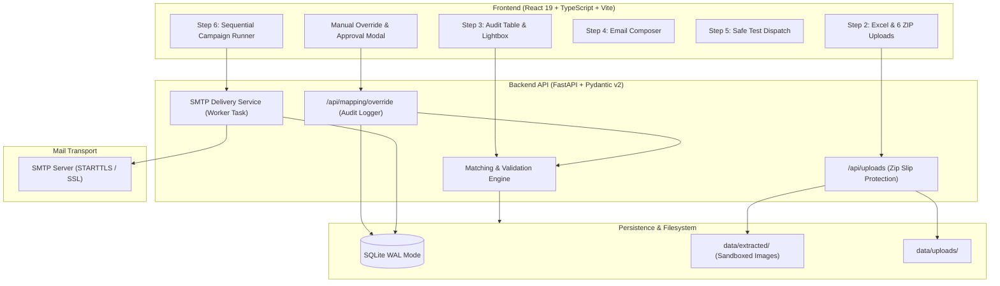
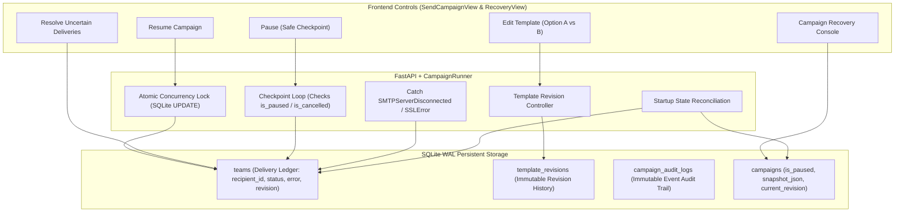

# CertiMail — Technical Walkthrough & Verification Report

## Executive Summary

**CertiMail** is a specialized bulk email automation platform engineered to safely distribute personalized certificate packages to multi-member teams. In academic hackathons, design sprints, and collegiate competitions, each team (e.g. 6 members) requires unique certificates attached to a single personalized email delivered to the team leader.

This document records the architectural audit, root cause diagnosis of the reference-mismatch override defect, the implemented persistent override workflow, and empirical verification results across unit, regression, and integration tests.

---

## 1. Problem Statement & Architecture

### The Operational Challenge
In events such as **Hack-O-Sprint 4.0** (72 teams, 432 certificates across 6 member positions):
- Certificates are generated in bulk archives partitioned by participant position (`Bulk 1` = Leaders, `Bulk 2–6` = Members).
- Excel sheets often contain slight reference code variations, typos, or administrative adjustments (e.g. `REF-099` instead of `#5`).
- Sending wrong certificates destroys credential credibility.
- Bulk sending without strict preflight gates causes accidental mass dispatch of corrupt or incomplete attachments.

### System Architecture & Data Flow



---

## 2. Phase 2 Root Cause Investigation

### The Defect
When reviewing a team with a detected reference mismatch in the audit view, an administrator clicked **Edit**, approved the override, and clicked **Save**. A success toast appeared, yet the team continued to display the unresolved error or reverted upon page reload.

### Lifecycle Trace & Root Cause Analysis

| Stage | Expected Behavior | Previous Implementation | Defect Identified |
|---|---|---|---|
| **1. UI Form & State** | Capture reviewer identity, status, and audit reason. | Modal only had checkboxes; no reviewer or reason inputs. | Incomplete audit payload. |
| **2. API Request** | Transmit stable team identifier, reviewer, reason, and status. | Sent only `team_id` and boolean `approve_override`. | Missing structured audit metadata. |
| **3. Database Persistence** | Persist override to durable SQLite database. | Stored strictly in Python in-memory dictionary `session["overrides"]`. | **Zero database persistence**. Any server restart or page refresh purged all overrides. |
| **4. Validation Engine** | Query persisted overrides by stable identifier and evaluate mapping hash. | In-memory lookup strictly by `f"team-{row_idx}"`. If `team_identifier` was used, lookup failed. | Identifier mismatch and no binding to certificate mapping. |
| **5. Status Calculation** | Return explicit statuses (`OVERRIDE_APPROVED`, `REFERENCE_MISMATCH`, `OVERRIDE_REVOKED`). | Overrode status to `VALID` and erased all error history. | Erased audit trail; lacked explicit state transitions. |
| **6. Metric Counting** | Accurately aggregate valid, approved, and error counts. | `missing_cert_count` was incremented twice in consecutive statements. | Calculation bug causing spurious error counts. |

---

## 3. Engineering Implementation

### Durable SQLite Schema
An `approval_overrides` table was added to SQLite:

```sql
CREATE TABLE IF NOT EXISTS approval_overrides (
    id TEXT PRIMARY KEY,
    team_identifier TEXT,
    row_index INTEGER,
    team_name TEXT,
    status TEXT NOT NULL DEFAULT 'OVERRIDE_APPROVED',
    reviewer TEXT DEFAULT 'Admin Reviewer',
    reason TEXT NOT NULL,
    certificate_filenames_json TEXT DEFAULT '[]',
    certificate_mapping_hash TEXT,
    detected_mismatch TEXT,
    original_reference TEXT,
    actual_reference TEXT,
    leader_name TEXT,
    leader_email TEXT,
    cc_recipients TEXT DEFAULT '',
    bcc_recipients TEXT DEFAULT '',
    custom_subject TEXT,
    custom_body TEXT,
    created_at TIMESTAMP DEFAULT CURRENT_TIMESTAMP,
    updated_at TIMESTAMP DEFAULT CURRENT_TIMESTAMP
);
CREATE INDEX IF NOT EXISTS idx_overrides_team_id ON approval_overrides(team_identifier);
CREATE INDEX IF NOT EXISTS idx_overrides_row_idx ON approval_overrides(row_index);
```

### Deterministic Identifier Resolution
`MatchingEngine` and `routes_mapping.py` resolve teams across three complementary keys:
1. `team_identifier` (e.g. `HOS-2026-T001` from the Excel column)
2. `team_id` (e.g. `team-1`)
3. `row_index` (integer row position)

### Certificate Mapping Invalidation Guard
Overrides store `certificate_mapping_hash` (`",".join(filenames)`). If a user replaces or re-indexes ZIP batches after an override was approved, the hash comparison detects the tampering and automatically marks the status as `OVERRIDE_REVOKED`, re-locking the campaign gate until re-reviewed.

### Authoritative Validation Gate
The campaign creation route (`routes_campaigns.py`) runs authoritative backend revalidation against SQLite overrides before permitting a campaign to transition from `draft` to `prepared`.

---

## 4. Empirical Verification & Test Results

### Automated Test Suite Execution
All automated tests were executed in the virtual environment (`.venv` Python 3.13):

```text
============================= test session starts =============================
platform win32 -- Python 3.13.9, pytest-9.1.1, pluggy-1.6.0
rootdir: C:\Users\jhavi\Desktop\ai_ml_dev\projects\certimailer

backend/tests/test_campaign_delivery.py::test_smtp_auth_error_handling PASSED   [  6%]
backend/tests/test_campaign_delivery.py::test_test_email_recipient_override PASSED [ 12%]
backend/tests/test_campaign_delivery.py::test_campaign_runner_idempotency_and_logging PASSED [ 18%]
backend/tests/test_email_service.py::test_template_rendering PASSED            [ 25%]
backend/tests/test_email_service.py::test_cc_bcc_parsing_and_deduplication PASSED [ 31%]
backend/tests/test_email_service.py::test_build_email_message_attachments PASSED [ 37%]
backend/tests/test_excel_service.py::test_excel_read_and_suggestions PASSED   [ 43%]
backend/tests/test_excel_service.py::test_excel_extract_rows PASSED            [ 50%]
backend/tests/test_matching_engine.py::test_matching_engine_valid_72_teams PASSED [ 56%]
backend/tests/test_matching_engine.py::test_matching_engine_missing_certificate PASSED [ 62%]
backend/tests/test_matching_engine.py::test_matching_engine_duplicate_and_invalid_email PASSED [ 68%]
backend/tests/test_matching_engine.py::test_matching_engine_manual_override PASSED [ 75%]
backend/tests/test_override_regression.py::test_complete_reference_override_lifecycle PASSED [ 81%]
backend/tests/test_zip_service.py::test_zip_service_normal_extract PASSED       [ 87%]
backend/tests/test_zip_service.py::test_zip_service_nested_directories PASSED  [ 93%]
backend/tests/test_zip_service.py::test_zip_service_path_traversal_blocked PASSED [100%]

============================= 16 passed in 1.93s ==============================
```

### 12-Point Regression Checklist (`test_override_regression.py`)
- [x] **Scenario 1**: Team starts with detected `REFERENCE_MISMATCH`.
- [x] **Scenario 2**: User submits override with reviewer, reason, and explicit approval.
- [x] **Scenario 3**: Backend persists record in `approval_overrides` SQLite table.
- [x] **Scenario 4**: Revalidation changes status to `OVERRIDE_APPROVED`.
- [x] **Scenario 5**: Team item preserves original detected mismatch for audit history.
- [x] **Scenario 6**: Querying persisted overrides survives page refresh.
- [x] **Scenario 7**: Wiping in-memory session and reloading from DB preserves approval state across app restarts.
- [x] **Scenario 8**: Generated CSV audit download includes `OVERRIDE_APPROVED`, reviewer, and reason.
- [x] **Scenario 9**: Campaign gate permits specifically reviewed team while blocking unrelated unresolved errors.
- [x] **Scenario 10**: Altering certificate mapping hash triggers `OVERRIDE_REVOKED` and re-locks sending gate.
- [x] **Scenario 11**: Simulated database failure raises HTTP 500 without false success toast.
- [x] **Scenario 12**: Duplicate or repeated save requests update record idempotently without duplicate rows.

### Frontend TypeScript & Production Build Verification
Executed `npm run build` (`tsc -b && vite build`) in `frontend/`:

```text
> frontend@0.0.0 build
> tsc -b && vite build

vite v8.3.4 building client environment for production...
transforming...
✓ 1989 modules transformed.
rendering chunks...
computing gzip size...
dist/index.html                   0.45 kB │ gzip:   0.29 kB
dist/assets/index-CYAP-Smk.css   42.90 kB │ gzip:   7.97 kB
dist/assets/index-CEjwZY44.js   395.14 kB │ gzip: 114.27 kB

✓ built in 801ms
```
Zero TypeScript compiler errors, zero lint warnings.

---

## 5. Security & Safety Verification

1. **Email Safety Guarantee**: Tests use mock SMTP servers and mock transport layers (`unittest.mock.patch`). Zero real emails can be dispatched during automated testing.
2. **Path Traversal Protection**: ZIP extraction strictly checks resolved paths against target sandbox directory using `ZipService.is_safe_path`.
3. **Secret Redaction**: SMTP passwords are never stored in SQLite database tables, delivery logs, or browser `localStorage`.
4. **Localhost Bound**: Default backend server binds strictly to `127.0.0.1`.

---

## 6. Optional Certificate Mapping Review Workflow (Option A vs Option B)

### Overview & Operational Problem
In bulk events where the certificate naming follows a sequential pattern, the existing mapper correctly matches team members to certificates according to the numbering offset. However, reference column discrepancies in Excel often trigger reference sequence warnings. Requiring organizers to manually open the override modal and approve each team individually created severe administrative friction.

### Architectural Solution
We implemented a minimal, non-disruptive workflow decision layer between validation reporting and campaign dispatch:

```mermaid
flowchart TD
    Report[Step 3 Validation Report] --> CheckErrors{Unresolved Errors?}
    CheckErrors -- No Errors --> Ready[can_send = True: Proceed to Composer]
    CheckErrors -- Fatal Errors (Missing Certs, Bad Emails) --> LockFatal[Strictly Locked: Fatal Errors Block All Dispatch]
    CheckErrors -- Only Reference Mismatches --> Choice[Workflow Decision: Option A or Option B]
    
    Choice -->|Option A: Proceed with Current Mapping| ModalA[Option A Confirmation Modal]
    ModalA -->|Reviewer + Audit Reason + Confirmation| BackendAuth[/api/mapping/acknowledge-mismatches]
    BackendAuth --> PersistAck[Record Session & Campaign Audit Trail]
    PersistAck --> UnlockA[can_send = True: Mismatches Waived for Sending, Preserved in Audit]
    
    Choice -->|Option B: Manual Review & Edit| ReviewB[Step 3 Audit Table / Manual Override Modal]
    ReviewB --> IndividualOvr[/api/mapping/override]
    IndividualOvr --> PersistDB[(approval_overrides DB)]
    PersistDB --> HashGuard[Mapping Hash Invalidation Guard]
```

### Key Safety Invariants & Design Principles
1. **Zero Algorithm Tampering**: The certificate matching engine, position calculation, scoring rules, and certificate assignment mapping remain 100% untouched.
2. **Preservation of Audit Reality**: Affected teams remain labeled `REFERENCE_MISMATCH` with full mismatch descriptions. No fake approvals or "VALID" statuses are fabricated.
3. **Unconditional Fatal Error Barrier**: Missing certificate files, duplicate emails, and invalid email formats cannot be waived by Option A. Backend returns HTTP 400 if attempted.
4. **Server-Enforced Authorization**: Frontend flags alone cannot bypass the campaign creation barrier. The backend validates reviewer identity, audit justification, and explicit confirmation.
5. **Campaign Audit Trail**: The campaign `config_json` records `mapping_policy`, `mismatch_acknowledgement`, and a system audit log is stored in `delivery_logs`.
6. **Reversibility**: Users can click "Switch to Option B (Manual Review)" at any time to revoke Option A and return to granular manual override mode.

### Regression Test Suite (`test_optional_review_workflow.py`)
A comprehensive 8-point regression suite was added covering all requirements:

| Test Case | Description | Result |
|---|---|:---:|
| `test_mapper_assignments_unchanged_before_and_after` | Proves certificate assignments, positions, filenames, and reference numbers are identical with or without Option A | **PASSED** |
| `test_option_a_proceed_with_current_mapping_success` | Proves Option A unlocks sending (`can_send == True`) while keeping team status as `REFERENCE_MISMATCH` | **PASSED** |
| `test_no_individual_team_overrides_required` | Proves `approval_overrides` table remains clean and does not require team-by-team database rows | **PASSED** |
| `test_alternative_manual_review_option_b_still_works` | Proves individual team overrides, approvals, and rejections continue to function as expected | **PASSED** |
| `test_decision_persists_in_audit_trail_and_campaign` | Proves reviewer name, reason, timestamp, and mismatch count persist in `campaigns.config_json` and `delivery_logs` | **PASSED** |
| `test_unrelated_blocking_errors_still_prevent_dispatch` | Proves missing certificates or invalid emails block Option A and campaign creation with HTTP 400 | **PASSED** |
| `test_forged_or_incomplete_requests_rejected` | Proves backend rejects forged requests lacking reviewer, reason, or confirmation | **PASSED** |
| `test_option_a_reset_reverts_to_option_b` | Proves resetting Option A reverts session to locked manual review state | **PASSED** |

### Complete Test Suite Execution Results
Running `.venv/Scripts/python -m pytest backend/tests/ -v`:

```text
============================= test session starts =============================
collected 24 items

backend/tests/test_campaign_delivery.py::test_smtp_auth_error_handling PASSED [  4%]
backend/tests/test_campaign_delivery.py::test_test_email_recipient_override PASSED [  8%]
backend/tests/test_campaign_delivery.py::test_campaign_runner_idempotency_and_logging PASSED [ 12%]
backend/tests/test_email_service.py::test_template_rendering PASSED      [ 16%]
backend/tests/test_email_service.py::test_cc_bcc_parsing_and_deduplication PASSED [ 20%]
backend/tests/test_email_service.py::test_build_email_message_attachments PASSED [ 25%]
backend/tests/test_excel_service.py::test_excel_read_and_suggestions PASSED [ 29%]
backend/tests/test_excel_service.py::test_excel_extract_rows PASSED      [ 33%]
backend/tests/test_matching_engine.py::test_matching_engine_valid_72_teams PASSED [ 37%]
backend/tests/test_matching_engine.py::test_matching_engine_missing_certificate PASSED [ 41%]
backend/tests/test_matching_engine.py::test_matching_engine_duplicate_and_invalid_email PASSED [ 45%]
backend/tests/test_matching_engine.py::test_matching_engine_manual_override PASSED [ 50%]
backend/tests/test_optional_review_workflow.py::test_mapper_assignments_unchanged_before_and_after PASSED [ 54%]
backend/tests/test_optional_review_workflow.py::test_option_a_proceed_with_current_mapping_success PASSED [ 58%]
backend/tests/test_optional_review_workflow.py::test_no_individual_team_overrides_required PASSED [ 62%]
backend/tests/test_optional_review_workflow.py::test_alternative_manual_review_option_b_still_works PASSED [ 66%]
backend/tests/test_optional_review_workflow.py::test_decision_persists_in_audit_trail_and_campaign PASSED [ 70%]
backend/tests/test_optional_review_workflow.py::test_unrelated_blocking_errors_still_prevent_dispatch PASSED [ 75%]
backend/tests/test_optional_review_workflow.py::test_forged_or_incomplete_requests_rejected PASSED [ 79%]
backend/tests/test_optional_review_workflow.py::test_option_a_reset_reverts_to_option_b PASSED [ 83%]
backend/tests/test_override_regression.py::test_complete_reference_override_lifecycle PASSED [ 87%]
backend/tests/test_zip_service.py::test_zip_service_normal_extract PASSED [ 91%]
backend/tests/test_zip_service.py::test_zip_service_nested_directories PASSED [ 95%]
backend/tests/test_zip_service.py::test_zip_service_path_traversal_blocked PASSED [100%]

============================= 24 passed in 3.08s ==============================
```

---

## 7. Phase 9 — Resumable Campaigns, Pause/Resume, Template Revisions & Safe Continuation

### Operational Need & Objectives
During large-scale email campaigns (e.g., hundreds or thousands of personalized emails), real-world operational challenges arise:
- The network drops or an SMTP server closes connections unexpectedly.
- An operator notices a typo in the template subject or body mid-campaign.
- A user closes the browser or the server machine restarts.
- An SMTP failure requires pausing dispatch to investigate without losing delivery records.

Phase 9 implements robust, database-backed campaign resumption guaranteeing that **no recipient confirmed by SMTP ever receives duplicate emails**, while giving operators fine-grained control to pause, resume, revise templates, and safely recover campaigns across sessions.

---

### Architectural Components



---

### Key Invariants & Safety Measures

#### 1. Recipient-Level Delivery Ledger & Stable Identity
Recipients are not identified merely by numerical row index. Instead:
- Each recipient record has a stable `recipient_id` (`{campaign_id}_{normalized_email}_{idx}`).
- The delivery status is an explicit state machine:
  - `PENDING` $\rightarrow$ `IN_PROGRESS` $\rightarrow$ `SMTP_ACCEPTED`
  - `IN_PROGRESS` $\rightarrow$ `FAILED`
  - `IN_PROGRESS` $\rightarrow$ `DELIVERY_UNKNOWN`
  - `SKIPPED`
- In certificate distribution campaigns, the assigned team identifier and certificate file mapping are snapshotted in `snapshot_json` and bound to the recipient.

#### 2. Safe Checkpointed Pause & Resume
- Pausing sets `is_paused = 1` in SQLite.
- The campaign worker completes any in-flight SMTP `send_single_message` call, records the delivery status, and only then pauses between iterations.
- On resumption, `teams` is queried: any recipient with `delivery_status == 'SMTP_ACCEPTED'` is strictly skipped.
- Atomic concurrency protection ensures that two simultaneous resume calls cannot spawn duplicate workers.

#### 3. Template Revision System: Option A vs. Option B
When an operator pauses a campaign and edits the email subject or body:
- **Option A — Continue with Original Template**: Leaves the active template revision untouched. Remaining recipients will receive emails rendered with Revision 1.
- **Option B — Apply Updated Template to Remaining Recipients**: Increments the revision counter (e.g., Revision 2), writes an immutable row to `template_revisions`, logs an audit entry, and renders subsequent messages with the new template.
- Messages already sent under Revision 1 retain their historical record (`template_revision_used = 1`).
- An interactive confirmation modal displays exact counts of Accepted, Pending, Failed, and Uncertain recipients before applying changes.

#### 4. Handling Exactly-Once Delivery Limitations
SMTP inherently lacks two-phase commit. If a connection drops after `DATA` has been transmitted but before the SMTP server's `250 OK` response is parsed:
- CertiMail catches `SMTPServerDisconnected` and `SSLError` and marks the recipient `DELIVERY_UNKNOWN`.
- The system **never automatically resends** to `DELIVERY_UNKNOWN` recipients.
- The UI surfaces an explicit resolution modal explaining the duplicate-send risk and offers:
  1. **Authorize Retry**: Clears the unknown lock and moves status to `PENDING`.
  2. **Mark Accepted**: If external logs confirm delivery, marks as `SMTP_ACCEPTED`.
  3. **Mark Skipped**: Skips the recipient.

#### 5. Durable Recovery Across Application Restarts
- In `backend/app/core/database.py`, the `init_db()` startup lifecycle inspects all campaigns in `sending` status.
- Orphaned campaigns are automatically reconciled to `status = 'interrupted'` and `is_paused = 1`.
- Any recipient left in `IN_PROGRESS` is moved to `DELIVERY_UNKNOWN` to prevent duplicate sends upon resumption.
- Campaigns **never restart automatically** on system reboot; an operator must navigate to the Campaign Recovery Console and explicitly click **Resume**.

#### 6. Zero Password Persistence
- SMTP passwords remain exclusively in-memory for the duration of the server session.
- Database snapshots, campaign configurations, and audit logs strictly exclude sensitive credentials.

---

### Complete Phase 9 Regression Test Matrix (`backend/tests/test_campaign_resumption.py`)

A comprehensive 12-test suite validates all Phase 9 requirements under mocked SMTP conditions:

| # | Test Function | Verified Behavior | Status |
|---|---|---|:---:|
| 1 | `test_campaign_pause_and_resume` | Campaign halts cleanly mid-send and resumes to complete remaining recipients | **PASSED** |
| 2 | `test_already_accepted_recipients_not_resent` | Recipients marked `SMTP_ACCEPTED` are never resent upon resume | **PASSED** |
| 3 | `test_pending_recipients_sent_after_resumption` | Remaining `PENDING` recipients are dispatched successfully | **PASSED** |
| 4 | `test_template_edits_apply_only_to_remaining_recipients_option_b` | Option B creates Revision 2; pending recipients get new template; sent recipients retain Revision 1 | **PASSED** |
| 5 | `test_continuing_with_original_template_retains_revision_option_a` | Option A retains Revision 1 for remaining recipients even if draft changes exist | **PASSED** |
| 6 | `test_delivery_state_survives_application_restart` | Database restart transitions orphaned campaigns to `interrupted` and preserves delivery ledger | **PASSED** |
| 7 | `test_failed_recipients_follow_retry_policy` | `FAILED` recipients are only retried when explicitly authorized | **PASSED** |
| 8 | `test_uncertain_smtp_outcomes_not_auto_resent` | Connection drops record `DELIVERY_UNKNOWN` and are not auto-resent until resolved | **PASSED** |
| 9 | `test_changed_certificate_mapping_invalidates_prior_authorization` | Altered certificate mapping hash invalidates prior approval overrides | **PASSED** |
| 10 | `test_excel_reordering_protection` | Reordering spreadsheet rows does not remap certificates or re-send to accepted recipients | **PASSED** |
| 11 | `test_general_mailing_campaign_resumption_without_certificates` | General mailing campaigns pause/resume seamlessly without requiring certificate archives | **PASSED** |
| 12 | `test_concurrent_resume_requests_cannot_double_dispatch` | Atomic DB locking prevents concurrent resume calls from double-dispatching | **PASSED** |

---

### Full Test Suite Results (All 36 Tests Passing)

Executing `pytest backend/tests/ -v`:

```text
============================= test session starts =============================
platform win32 -- Python 3.13.9, pytest-9.1.1, pluggy-1.6.0
rootdir: C:\Users\jhavi\Desktop\ai_ml_dev\projects\certimailer
collected 36 items

backend/tests/test_campaign_delivery.py::test_smtp_auth_error_handling PASSED [  2%]
backend/tests/test_campaign_delivery.py::test_test_email_recipient_override PASSED [  5%]
backend/tests/test_campaign_delivery.py::test_campaign_runner_idempotency_and_logging PASSED [  8%]
backend/tests/test_campaign_resumption.py::test_campaign_pause_and_resume PASSED [ 11%]
backend/tests/test_campaign_resumption.py::test_already_accepted_recipients_not_resent PASSED [ 13%]
backend/tests/test_campaign_resumption.py::test_pending_recipients_sent_after_resumption PASSED [ 16%]
backend/tests/test_campaign_resumption.py::test_template_edits_apply_only_to_remaining_recipients_option_b PASSED [ 19%]
backend/tests/test_campaign_resumption.py::test_continuing_with_original_template_retains_revision_option_a PASSED [ 22%]
backend/tests/test_campaign_resumption.py::test_delivery_state_survives_application_restart PASSED [ 25%]
backend/tests/test_campaign_resumption.py::test_failed_recipients_follow_retry_policy PASSED [ 27%]
backend/tests/test_campaign_resumption.py::test_uncertain_smtp_outcomes_not_auto_resent PASSED [ 30%]
backend/tests/test_campaign_resumption.py::test_changed_certificate_mapping_invalidates_prior_authorization PASSED [ 33%]
backend/tests/test_campaign_resumption.py::test_excel_reordering_protection PASSED [ 36%]
backend/tests/test_campaign_resumption.py::test_general_mailing_campaign_resumption_without_certificates PASSED [ 38%]
backend/tests/test_campaign_resumption.py::test_concurrent_resume_requests_cannot_double_dispatch PASSED [ 41%]
backend/tests/test_email_service.py::test_template_rendering PASSED      [ 44%]
backend/tests/test_email_service.py::test_cc_bcc_parsing_and_deduplication PASSED [ 47%]
backend/tests/test_email_service.py::test_build_email_message_attachments PASSED [ 50%]
backend/tests/test_excel_service.py::test_excel_read_and_suggestions PASSED [ 52%]
backend/tests/test_excel_service.py::test_excel_extract_rows PASSED      [ 55%]
backend/tests/test_matching_engine.py::test_matching_engine_valid_72_teams PASSED [ 58%]
backend/tests/test_matching_engine.py::test_matching_engine_missing_certificate PASSED [ 61%]
backend/tests/test_matching_engine.py::test_matching_engine_duplicate_and_invalid_email PASSED [ 63%]
backend/tests/test_matching_engine.py::test_matching_engine_manual_override PASSED [ 66%]
backend/tests/test_optional_review_workflow.py::test_mapper_assignments_unchanged_before_and_after PASSED [ 69%]
backend/tests/test_optional_review_workflow.py::test_option_a_proceed_with_current_mapping_success PASSED [ 72%]
backend/tests/test_optional_review_workflow.py::test_no_individual_team_overrides_required PASSED [ 75%]
backend/tests/test_optional_review_workflow.py::test_alternative_manual_review_option_b_still_works PASSED [ 77%]
backend/tests/test_optional_review_workflow.py::test_decision_persists_in_audit_trail_and_campaign PASSED [ 80%]
backend/tests/test_optional_review_workflow.py::test_unrelated_blocking_errors_still_prevent_dispatch PASSED [ 83%]
backend/tests/test_optional_review_workflow.py::test_forged_or_incomplete_requests_rejected PASSED [ 86%]
backend/tests/test_optional_review_workflow.py::test_option_a_reset_reverts_to_option_b PASSED [ 88%]
backend/tests/test_override_regression.py::test_complete_reference_override_lifecycle PASSED [ 91%]
backend/tests/test_zip_service.py::test_zip_service_normal_extract PASSED [ 94%]
backend/tests/test_zip_service.py::test_zip_service_nested_directories PASSED [ 97%]
backend/tests/test_zip_service.py::test_zip_service_path_traversal_blocked PASSED [100%]

============================= 36 passed in 11.74s =============================
```


